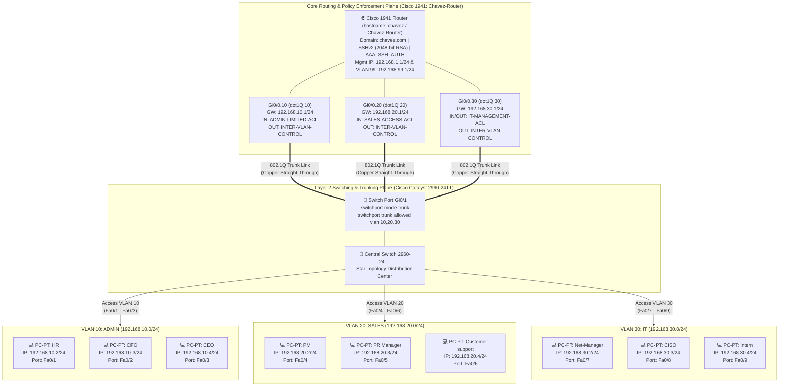

# Enterprise Branch Network Architecture & Security Simulation: VLAN Segmentation, 802.1Q Router-on-a-Stick, Extended ACLs & AAA/SSHv2 Hardening


> **Executive Summary:** Designed and implemented a secure enterprise branch office network architecture for **Chavez Finance (Enugu Branch Office)** using **Cisco Packet Tracer (`v8.2.2`)**. To eliminate flat-network broadcast domains and prevent unauthorized lateral movement between departments, the topology segments nine departmental workstations across three isolated Virtual Local Area Networks (**`ADMIN` VLAN 10**, **`SALES` VLAN 20**, and **`IT` VLAN 30**) on a **Cisco Catalyst 2960-24TT** switch, establishes **IEEE 802.1Q Router-on-a-Stick** inter-VLAN routing on a **Cisco 1941 Router**, enforces granular **Extended Named Access Control Lists (ACLs)** aligned with least-privilege business policies, and secures the control plane using **2048-bit RSA SSHv2 encryption** and **AAA (`SSH_AUTH`)** local authentication.

| Field | Detail |
| :--- | :--- |
| **Client / Scenario** | Chavez Finance — Enugu Branch Office Infrastructure Simulation |
| **Network Security Engineer** | Chinaza Nnamani |
| **Simulation Platform** | Cisco Packet Tracer `v8.2.2` (`Project.pkt`) |
| **Core Network Hardware** | Cisco `1941` Integrated Services Router (`Chavez-Router`) & Cisco Catalyst `2960-24TT` Switch |
| **Network Topology** | Hierarchical Star / Router-on-a-Stick Topology (Copper Straight-Through Cabling) |
| **Security Controls Implemented** | Layer 2 VLAN Segmentation, 802.1Q Trunking, Extended Named ACLs, AAA New-Model, SSHv2 (`aes128-cbc` / `hmac-sha1`) |

---

## Table of Contents
- [Tools Used](#tools-used)
- [Skills Learned](#skills-learned)
- [1. Problem Statement & Objectives](#1-problem-statement--objectives)
- [2. Architecture & Design Overview](#2-architecture--design-overview)
- [3. Technology Stack & Tooling](#3-technology-stack--tooling)
- [4. Full Documentation Index](#4-full-documentation-index)
- [5. Implementation Walkthrough](#5-implementation-walkthrough)
  - [Phase 1: Network Design & Layer 2 VLAN Segmentation](#phase-1-network-design--layer-2-vlan-segmentation)
  - [Phase 2: IEEE 802.1Q Trunking & Router-on-a-Stick Inter-VLAN Routing](#phase-2-ieee-8021q-trunking--router-on-a-stick-inter-vlan-routing)
  - [Phase 3: Extended Access Control Lists (ACLs) & Security Justification](#phase-3-extended-access-control-lists-acls--security-justification)
  - [Phase 4: Control-Plane Hardening — Secure Remote Access (SSHv2 & AAA)](#phase-4-control-plane-hardening--secure-remote-access-sshv2--aaa)
- [6. Validation, Testing & Proof of Work](#6-validation-testing--proof-of-work)
- [7. Key Challenges & Trade-Offs](#7-key-challenges--trade-offs)
- [8. Future Enhancements](#8-future-enhancements)
- [Author & Contact](#author--contact)

---

## Tools Used

**Networking Hardware & Simulation**  

-005073?style=for-the-badge&logo=cisco&logoColor=white)


**Routing, Switching & Network Protocols**  
-4682B4?style=for-the-badge)


**Network Security & Control-Plane Hardening**  

-232F3E?style=for-the-badge)
-FF9900?style=for-the-badge)

---

## Skills Learned

**Architecture & Network Engineering**  


**Network Security & Governance**  


---

## 1. Problem Statement & Objectives

### Background & Risk / Bottleneck
In unsegmented branch office networks where all employee workstations share a single broadcast domain and subnet, a compromised workstation in a customer-facing department (**Sales**) has unrestricted Layer 2/Layer 3 reachability to sensitive executive and financial endpoints (**Admin**: `CEO`, `CFO`, `HR`) as well as core infrastructure administration terminals (**IT**: `CISO`, `Net-Manager`). Furthermore, default switch and router configurations permit cleartext management protocols (**Telnet** on VTY lines `0–15`) and lack inter-VLAN packet filtering, exposing financial institutions like **Chavez Finance** to credential sniffing, unauthorized lateral movement, and regulatory compliance failures.

### Core Objectives
* **Objective 1 (Departmental VLAN Segmentation):** Design a scalable Star topology in Cisco Packet Tracer for the Chavez Finance Enugu Branch Office, segmenting nine departmental workstations across three dedicated VLANs: **`ADMIN` (VLAN 10 — `192.168.10.0/24`)**, **`SALES` (VLAN 20 — `192.168.20.0/24`)**, and **`IT` (VLAN 30 — `192.168.30.0/24`)**.
* **Objective 2 (802.1Q Trunking & Router-on-a-Stick Inter-VLAN Routing):** Configure `GigabitEthernet 0/1` on the Catalyst `2960-24TT` switch as an IEEE 802.1Q trunk (`allowed vlan 10,20,30`) and provision `dot1Q` sub-interfaces (`Gi0/0.10`, `Gi0/0.20`, `Gi0/0.30`) on the Cisco `1941` router to act as departmental default gateways.
* **Objective 3 (Extended ACL Policy Enforcement):** Engineer and apply Extended Named IP Access Control Lists (`INTER-VLAN-CONTROL`, `IT-MANAGEMENT-ACL`, `ADMIN-LIMITED-ACL`, and `SALES-ACCESS-ACL`) to enforce strict departmental trust boundaries, restricting protocol usage (`HTTPS 443`, `SSH 22`, `RDP 3389`, `DNS 53`) and blocking unauthorized cross-departmental access.
* **Objective 4 (Encrypted Remote Management via SSHv2 & AAA):** Eliminate cleartext Telnet exposure by generating a `2048-bit` RSA key pair on `Chavez-Router` (`chavez.com`), enabling **SSHv2**, configuring **Cisco AAA (`SSH_AUTH`)** against local privilege-15 encrypted secrets, locking down `line vty 0 4` to SSH-only with idle timeouts, and disabling unused VTY lines (`5 15`).

> [!IMPORTANT]
> **Scope Note:** This `README.md` is a complete, self-contained network security case study and Cisco IOS configuration runbook. It consolidates the full topology design, VLAN port mappings, router sub-interface configurations, extended ACL rule justifications, SSHv2/AAA hardening scripts, and ICMP/SSH validation outputs without requiring external documentation files.

---

## 2. Architecture & Design Overview

### System Workflow & Network Topology (Mermaid Diagram)



### Key Design Decisions
1. **Hierarchical Star Topology with Departmental VLAN Isolation:** Grouping endpoints logically into `VLAN 10 (ADMIN)`, `VLAN 20 (SALES)`, and `VLAN 30 (IT)` on the Catalyst 2960-24TT switch ensures that Layer 2 broadcast frames (such as ARP requests) remain strictly contained within each department, preventing ARP spoofing across departments and allowing additional PCs to be scaled effortlessly into unused ports (`Fa0/10–Fa0/24`).
2. **Router-on-a-Stick (`802.1Q` Sub-Interfaces) with Switch SVI Decommissioning:** During Phase 1, temporary Switch Virtual Interfaces (`interface vlan 10/20/30`) were used to validate Layer 2 isolation. When transitioning to Phase 2 inter-VLAN routing on the Cisco 1941 router (`Gi0/0.10`, `Gi0/0.20`, `Gi0/0.30`), the switch SVIs were explicitly removed (`no interface vlan 10/20/30`) to eliminate duplicate gateway IP conflicts (`192.168.x.1`) and force all cross-subnet packets through the router's ACL inspection engine.
3. **Defense-in-Depth Extended ACL Architecture:** Rather than relying on basic standard ACLs that only filter by source IP, Extended Named ACLs (`INTER-VLAN-CONTROL`, `ADMIN-LIMITED-ACL`, `SALES-ACCESS-ACL`, `IT-MANAGEMENT-ACL`) were engineered to filter by source subnet, destination subnet, transport protocol (`TCP`/`UDP`/`IP`), and destination port (`eq 443`, `eq 22`, `eq 3389`, `eq 53`), concluding with an explicit `deny ip any any` rule for audit clarity.
4. **Zero-Telnet Control Plane (`SSHv2` + `AAA` + Unused VTY Lockdown):** Configuring `transport input ssh` on `line vty 0 4` alongside `no transport input` on `line vty 5 15` ensures that cleartext Telnet (`TCP 23`) is completely disabled across all 16 virtual terminal lines, while `aaa new-model` enforces local credential verification (`SSH_AUTH`) and a 10-minute idle timeout (`exec-timeout 10 0`).

---

## 3. Technology Stack & Tooling

### Branch Office Subnet, VLAN & Endpoint Matrix

| VLAN ID | VLAN Name | Assigned Subnet | Default Gateway (`1941 Router`) | Switch Access Ports (`2960-24TT`) | Departmental Workstations & Static IPs |
| :--- | :--- | :--- | :--- | :--- | :--- |
| **VLAN 10** | `ADMIN` | `192.168.10.0/24` (`255.255.255.0`) | `192.168.10.1` (`Gi0/0.10`) | `FastEthernet 0/1 – 0/3` | `HR` (`192.168.10.2`), `CFO` (`192.168.10.3`), `CEO` (`192.168.10.4`) |
| **VLAN 20** | `SALES` | `192.168.20.0/24` (`255.255.255.0`) | `192.168.20.1` (`Gi0/0.20`) | `FastEthernet 0/4 – 0/6` | `PM` (`192.168.20.2`), `PR Manager` (`192.168.20.3`), `Customer support` (`192.168.20.4`) |
| **VLAN 30** | `IT` | `192.168.30.0/24` (`255.255.255.0`) | `192.168.30.1` (`Gi0/0.30`) | `FastEthernet 0/7 – 0/9` | `Net-Manager` (`192.168.30.2`), `CISO` (`192.168.30.3`), `Intern` (`192.168.30.4`) |
| **VLAN 99 / Mgmt** | `Management` | `192.168.99.0/24` & `192.168.1.0/24` | `192.168.99.1` / `192.168.1.1` | `Gi0/1` (802.1Q Trunk) | Router SSHv2 Management Interface (`Chavez-Router`) |

### Hardware & Protocol Stack

| Category | Component / Protocol | Role in This Project | Why It Was Chosen |
| :--- | :--- | :--- | :--- |
| **Core Router** | Cisco `1941` ISR (`Chavez-Router`) | Inter-VLAN routing (`Gi0/0.10–.30`), Extended ACL enforcement, and SSHv2 server | Enterprise branch router supporting 802.1Q sub-interfaces, AAA, and cryptographic IOS features |
| **Distribution Switch** | Cisco Catalyst `2960-24TT` | Layer 2 Star hub, access port VLAN binding (`Fa0/1–0/9`), and `Gi0/1` 802.1Q trunking | Industry-standard 24-port access switch with hardware VLAN isolation |
| **Trunk Encapsulation** | IEEE `802.1Q` (`dot1Q`) | Tags VLAN frames (`10, 20, 30`) across the single physical Gigabit uplink | Enables multi-subnet routing over a single physical router interface (Router-on-a-Stick) |
| **Packet Filtering** | Cisco IOS Extended Named ACLs | Enforces granular Layer 3/Layer 4 inter-departmental security policies | Provides human-readable remarks, sequence numbering (`10–60`), and port-level filtering |
| **Remote Management** | `SSHv2` (`RSA 2048-bit`, `AES-128-CBC`, `HMAC-SHA1`) + `AAA` | Secures remote CLI administration and replaces insecure Telnet | Encrypts management traffic in transit and enforces centralized local authentication |

---

## 4. Full Documentation Index

All network schematics, Cisco IOS configuration scripts, security policy justifications, and verification outputs are consolidated directly inside this `README.md`:

```text
chavez-finance-network-simulation/
├── Project.pkt                              # Cisco Packet Tracer 8.2.2 Simulation File
├── Network_configuration_Simulation.pdf     # Original 24-Page Engineering Documentation Report
└── README.md                                # Complete Self-Contained Case Study & Cisco IOS Runbook
```

| Section Link | Description |
| :--- | :--- |
| [**Phase 1: VLAN Segmentation**](#phase-1-network-design--layer-2-vlan-segmentation) | Creating VLANs `10`, `20`, `30` on the 2960 Switch, binding `Fa0/1–0/9`, assigning static IPs, and verifying intra-VLAN isolation. |
| [**Phase 2: Inter-VLAN Routing**](#phase-2-ieee-8021q-trunking--router-on-a-stick-inter-vlan-routing) | Configuring the `Gi0/1` trunk on the switch, provisioning `dot1Q` sub-interfaces on Router 1941, removing switch SVIs, and testing cross-VLAN pings. |
| [**Phase 3: Extended ACLs & Justifications**](#phase-3-extended-access-control-lists-acls--security-justification) | Configuring `INTER-VLAN-CONTROL` and protocol-specific ACLs, binding to sub-interfaces, and documenting all 6 rule justifications. |
| [**Phase 4: Secure Remote Access (SSHv2 & AAA)**](#phase-4-control-plane-hardening--secure-remote-access-sshv2--aaa) | Generating 2048-bit RSA keys, enabling SSHv2 and AAA (`SSH_AUTH`), locking down VTY lines, and verifying encrypted SSH sessions. |

---

## 5. Implementation Walkthrough

### Phase 1: Network Design & Layer 2 VLAN Segmentation
To segment the Chavez Finance Enugu Branch Office into isolated broadcast domains, we provisioned three departmental VLANs on the central **Cisco Catalyst 2960-24TT** switch, bound the corresponding `FastEthernet` access ports, and assigned static IPv4 addresses to all nine departmental PCs:

* **VLAN Creation:** Defined `VLAN 10` (`ADMIN`), `VLAN 20` (`SALES`), and `VLAN 30` (`IT`).
* **Access Port Allocation:**
  * `FastEthernet 0/1 – 0/3` -> Assigned to **`VLAN 10` (`ADMIN`)** (`HR`, `CFO`, `CEO`).
  * `FastEthernet 0/4 – 0/6` -> Assigned to **`VLAN 20` (`SALES`)** (`PM`, `PR Manager`, `Customer support`).
  * `FastEthernet 0/7 – 0/9` -> Assigned to **`VLAN 30` (`IT`)** (`Net-Manager`, `CISO`, `Intern`).
* **Initial Intra-VLAN Verification:** Configured each PC with its static IPv4 address, subnet mask (`255.255.255.0`), default gateway (`192.168.x.1`), and DNS (`8.8.8.8`). Tested `ping` from `CFO` (`192.168.10.3`) to `CEO` (`192.168.10.4` — `0% loss`) vs. `192.168.30.2` (`100% loss`), and from `CISO` (`192.168.30.3` — `0% loss`) vs. `192.168.10.2` (`100% loss`), confirming that hosts could communicate strictly within their own subnet by default.

<details>
<summary><strong>Click to expand: Phase 1 Cisco Catalyst 2960 Switch CLI Configuration & Verification</strong></summary>

```ios
! 1. Create Departmental VLANs (10, 20, 30)
Switch> enable
Switch# configure terminal
Switch(config)# vlan 10
Switch(config-vlan)# name ADMIN
Switch(config-vlan)# exit
Switch(config)# vlan 20
Switch(config-vlan)# name SALES
Switch(config-vlan)# exit
Switch(config)# vlan 30
Switch(config-vlan)# name IT
Switch(config-vlan)# exit

! 2. Assign FastEthernet 0/1 - 0/3 to ADMIN (VLAN 10)
Switch(config)# interface fastEthernet 0/1
Switch(config-if)# switchport mode access
Switch(config-if)# switchport access vlan 10
Switch(config-if)# exit
Switch(config)# interface fastEthernet 0/2
Switch(config-if)# switchport mode access
Switch(config-if)# switchport access vlan 10
Switch(config-if)# exit
Switch(config)# interface fastEthernet 0/3
Switch(config-if)# switchport mode access
Switch(config-if)# switchport access vlan 10
Switch(config-if)# exit

! 3. Assign FastEthernet 0/4 - 0/6 to SALES (VLAN 20)
Switch(config)# interface fastEthernet 0/4
Switch(config-if)# switchport mode access
Switch(config-if)# switchport access vlan 20
Switch(config-if)# exit
Switch(config)# interface fastEthernet 0/5
Switch(config-if)# switchport mode access
Switch(config-if)# switchport access vlan 20
Switch(config-if)# exit
Switch(config)# interface fastEthernet 0/6
Switch(config-if)# switchport mode access
Switch(config-if)# switchport access vlan 20
Switch(config-if)# exit

! 4. Assign FastEthernet 0/7 - 0/9 to IT (VLAN 30)
Switch(config)# interface fastEthernet 0/7
Switch(config-if)# switchport mode access
Switch(config-if)# switchport access vlan 30
Switch(config-if)# exit
Switch(config)# interface fastEthernet 0/8
Switch(config-if)# switchport mode access
Switch(config-if)# switchport access vlan 30
Switch(config-if)# exit
Switch(config)# interface fastEthernet 0/9
Switch(config-if)# switchport mode access
Switch(config-if)# switchport access vlan 30
Switch(config-if)# exit
```

```text
Switch# show vlan brief

VLAN Name                             Status    Ports
---- -------------------------------- --------- -------------------------------
1    default                          active    Fa0/10, Fa0/11, Fa0/12, Fa0/13
                                                Fa0/14, Fa0/15, Fa0/16, Fa0/17
                                                Fa0/18, Fa0/19, Fa0/20, Fa0/21
                                                Fa0/22, Fa0/23, Fa0/24, Gi0/1
                                                Gi0/2
10   ADMIN                            active    Fa0/1, Fa0/2, Fa0/3
20   SALES                            active    Fa0/4, Fa0/5, Fa0/6
30   IT                               active    Fa0/7, Fa0/8, Fa0/9
1002 fddi-default                     active    
1003 token-ring-default               active    
1004 fddinet-default                  active    
1005 trnet-default                    active    
```

</details>

---

### Phase 2: IEEE 802.1Q Trunking & Router-on-a-Stick Inter-VLAN Routing
To enable controlled communication across the three VLANs, we configured an **802.1Q Trunk** on the switch uplink (`GigabitEthernet 0/1`) and configured **Router-on-a-Stick** sub-interfaces on the **Cisco 1941 Router (`GigabitEthernet 0/0`)**:

* **Switch Trunk Configuration:** Configured `interface gigabitEthernet 0/1` with `switchport mode trunk` and restricted the trunk to carry only `vlan 10,20,30`.
* **Router Sub-Interface Provisioning (`encapsulation dot1Q`):**
  * `GigabitEthernet 0/0.10`: `encapsulation dot1Q 10` -> `192.168.10.1/24` (`ADMIN` Gateway)
  * `GigabitEthernet 0/0.20`: `encapsulation dot1Q 20` -> `192.168.20.1/24` (`SALES` Gateway)
  * `GigabitEthernet 0/0.30`: `encapsulation dot1Q 30` -> `192.168.30.1/24` (`IT` Gateway)
* **Removing Temporary Switch SVIs:** Executed `no interface vlan 10`, `no interface vlan 20`, and `no interface vlan 30` on the switch so the L2 switch SVIs would not conflict with the router's sub-interface gateway IPs.
* **Verifying Inter-VLAN Routing:** From `HR` (`192.168.10.2` in `ADMIN`) and `PM` (`192.168.20.2` in `SALES`), successfully pinged hosts across all three subnets (`192.168.10.4`, `192.168.20.2`, `192.168.30.2`, `192.168.30.4` — `TTL=127` confirming Layer 3 router hop traversal after initial ARP resolution).

<details>
<summary><strong>Click to expand: Phase 2 Switch Trunk & Router 1941 Sub-Interface CLI Commands</strong></summary>

```ios
! --- ON SWITCH 2960-24TT: Configure 802.1Q Trunk & Remove Temporary SVIs ---
Switch(config)# interface gigabitEthernet 0/1
Switch(config-if)# switchport mode trunk
Switch(config-if)# switchport trunk allowed vlan 10,20,30
Switch(config-if)# exit

! Remove temporary Switch VLAN interfaces to avoid IP conflict with Router
Switch(config)# no interface vlan 10
Switch(config)# no interface vlan 20
Switch(config)# no interface vlan 30
Switch(config)# exit
```

```ios
! --- ON ROUTER 1941: Configure 802.1Q Sub-Interfaces (Router-on-a-Stick) ---
Router> enable
Router# configure terminal
Router(config)# interface gigabitEthernet 0/0
Router(config-if)# no shutdown

! Sub-interface for ADMIN (VLAN 10)
Router(config-if)# interface gigabitEthernet 0/0.10
Router(config-subif)# encapsulation dot1Q 10
Router(config-subif)# ip address 192.168.10.1 255.255.255.0
Router(config-subif)# exit

! Sub-interface for SALES (VLAN 20)
Router(config)# interface gigabitEthernet 0/0.20
Router(config-subif)# encapsulation dot1Q 20
Router(config-subif)# ip address 192.168.20.1 255.255.255.0
Router(config-subif)# exit

! Sub-interface for IT (VLAN 30)
Router(config)# interface gigabitEthernet 0/0.30
Router(config-subif)# encapsulation dot1Q 30
Router(config-subif)# ip address 192.168.30.1 255.255.255.0
Router(config-subif)# exit
```

</details>

---

### Phase 3: Extended Access Control Lists (ACLs) & Security Justification
With inter-VLAN routing operational, we engineered four **Extended Named IP Access Control Lists** on the Cisco 1941 Router and bound them to the sub-interfaces (`Gi0/0.10`, `Gi0/0.20`, `Gi0/0.30`) to enforce departmental security boundaries:

1. **`INTER-VLAN-CONTROL` (Core Inter-Departmental Policy):**
   * Permits `IT` (`192.168.30.0/24`) full access to all networks (`any`).
   * Permits `ADMIN` (`192.168.10.0/24`) to access `SALES` (`192.168.20.0/24`) for financial reporting.
   * Denies `ADMIN` (`192.168.10.0/24`) from accessing `IT` (`192.168.30.0/24`).
   * Denies `SALES` (`192.168.20.0/24`) from accessing `ADMIN` (`192.168.10.0/24`) to protect HR and executive financial data.
   * Permits `SALES` (`192.168.20.0/24`) to access `IT` (`192.168.30.0/24`) for helpdesk/system support.
   * Explicitly denies all other traffic (`deny ip any any`).
2. **Protocol-Specific Enhanced Security ACLs:**
   * **`IT-MANAGEMENT-ACL`:** Permits `192.168.30.0/24` to use all management protocols (`permit ip 192.168.30.0 0.0.0.255 any`).
   * **`ADMIN-LIMITED-ACL`:** Restricts `ADMIN` (`192.168.10.0/24`) to `HTTPS` (`TCP port 443`) when accessing `SALES` (`192.168.20.0/24`) for reporting, denying all other inter-VLAN traffic (`deny ip 192.168.10.0 0.0.0.255 any`).
   * **`SALES-ACCESS-ACL`:** Restricts `SALES` (`192.168.20.0/24`) to `SSH` (`TCP 22`), `RDP` (`TCP 3389`), and `DNS` (`UDP 53 / domain`) when communicating with `IT` (`192.168.30.0/24`), while explicitly denying access to `ADMIN` (`192.168.10.0/24`).

#### Security Justification Matrix (`INTER-VLAN-CONTROL`)

| Rule Seq | ACL Statement | Security & Business Justification |
| :--- | :--- | :--- |
| **Rule 1 (`10`)** | `permit ip 192.168.30.0 0.0.0.255 any` | **Principle of Least Privilege Exception & Operational Necessity:** IT staff require broad network reachability to perform system maintenance, patching, monitoring, and incident response across all departments, backed by strong authentication and auditing controls. |
| **Rule 2 (`20`)** | `permit ip 192.168.10.0 0.0.0.255 192.168.20.0 0.0.0.255` | **Business Reporting & Unidirectional Flow:** Admin staff require access to Sales data for financial reporting and analysis while maintaining departmental segmentation. |
| **Rule 3 (`30`)** | `deny ip 192.168.10.0 0.0.0.255 192.168.30.0 0.0.0.255` | **Separation of Duties & Reduced Attack Surface:** Financial and administrative staff should not access core IT infrastructure, limiting lateral movement if an Admin workstation is compromised. |
| **Rule 4 (`40`)** | `deny ip 192.168.20.0 0.0.0.255 192.168.10.0 0.0.0.255` | **Data Protection & Confidentiality:** Prevents customer-facing Sales workstations from accessing sensitive HR and executive financial records in the Admin VLAN. |
| **Rule 5 (`50`)** | `permit ip 192.168.20.0 0.0.0.255 192.168.30.0 0.0.0.255` | **Operational Support & Business Enablement:** Allows the Sales team to reach IT helpdesk and support systems so CRM and sales tools remain operational. |
| **Rule 6 (`60`)** | `deny ip any any` | **Defense-in-Depth Default Deny:** Makes the implicit deny explicit in the configuration to provide clear hit-count logging and compliance audit trails. |

<details>
<summary><strong>Click to expand: Phase 3 Extended ACL Definitions, Interface Bindings & Verification</strong></summary>

```ios
! 1. Create Extended ACL for Core Inter-VLAN Traffic Control
Router(config)# ip access-list extended INTER-VLAN-CONTROL
Router(config-ext-nacl)# remark IT has full access to all networks for admin purposes
Router(config-ext-nacl)# permit ip 192.168.30.0 0.0.0.255 any
Router(config-ext-nacl)# remark Admin can access Sales for reporting but not IT
Router(config-ext-nacl)# permit ip 192.168.10.0 0.0.0.255 192.168.20.0 0.0.0.255
Router(config-ext-nacl)# remark Admin cannot access IT department
Router(config-ext-nacl)# deny ip 192.168.10.0 0.0.0.255 192.168.30.0 0.0.0.255
Router(config-ext-nacl)# remark Sales cannot access Admin for security
Router(config-ext-nacl)# deny ip 192.168.20.0 0.0.0.255 192.168.10.0 0.0.0.255
Router(config-ext-nacl)# remark Sales can access IT for system support
Router(config-ext-nacl)# permit ip 192.168.20.0 0.0.0.255 192.168.30.0 0.0.0.255
Router(config-ext-nacl)# remark DEFAULT DENY FOR INTER-VLAN
Router(config-ext-nacl)# deny ip any any
Router(config-ext-nacl)# exit

! 2. Create Additional Protocol-Specific ACLs (Enhanced Security)
Router(config)# ip access-list extended IT-MANAGEMENT-ACL
Router(config-ext-nacl)# remark Allow IT to use all protocols for management
Router(config-ext-nacl)# permit ip 192.168.30.0 0.0.0.255 any
Router(config-ext-nacl)# exit

Router(config)# ip access-list extended ADMIN-LIMITED-ACL
Router(config-ext-nacl)# remark Admin can only use HTTP/HTTPS to Sales for reports
Router(config-ext-nacl)# permit tcp 192.168.10.0 0.0.0.255 192.168.20.0 0.0.0.255 eq 443
Router(config-ext-nacl)# remark Deny all other inter-VLAN traffic from Admin
Router(config-ext-nacl)# deny ip 192.168.10.0 0.0.0.255 any
Router(config-ext-nacl)# exit

Router(config)# ip access-list extended SALES-ACCESS-ACL
Router(config-ext-nacl)# remark Sales can use specific protocols to IT
Router(config-ext-nacl)# permit tcp 192.168.20.0 0.0.0.255 192.168.30.0 0.0.0.255 eq 22
Router(config-ext-nacl)# permit tcp 192.168.20.0 0.0.0.255 192.168.30.0 0.0.0.255 eq 3389
Router(config-ext-nacl)# permit udp 192.168.20.0 0.0.0.255 192.168.30.0 0.0.0.255 eq 53
Router(config-ext-nacl)# remark Deny Sales access to Admin completely
Router(config-ext-nacl)# deny ip 192.168.20.0 0.0.0.255 192.168.10.0 0.0.0.255
Router(config-ext-nacl)# exit

! 3. Apply ACLs to Router Subinterfaces (Inbound & Outbound)
Router(config)# interface gigabitEthernet 0/0.10
Router(config-subif)# ip access-group INTER-VLAN-CONTROL out
Router(config-subif)# ip access-group ADMIN-LIMITED-ACL in
Router(config-subif)# exit

Router(config)# interface gigabitEthernet 0/0.20
Router(config-subif)# ip access-group INTER-VLAN-CONTROL out
Router(config-subif)# ip access-group SALES-ACCESS-ACL in
Router(config-subif)# exit

Router(config)# interface gigabitEthernet 0/0.30
Router(config-subif)# ip access-group INTER-VLAN-CONTROL out
Router(config-subif)# ip access-group IT-MANAGEMENT-ACL in
Router(config-subif)# exit
```

```text
Router# show access-lists
Extended IP access list INTER-VLAN-CONTROL
    10 permit ip 192.168.30.0 0.0.0.255 any
    20 permit ip 192.168.10.0 0.0.0.255 192.168.20.0 0.0.0.255
    30 deny ip 192.168.10.0 0.0.0.255 192.168.30.0 0.0.0.255
    40 deny ip 192.168.20.0 0.0.0.255 192.168.10.0 0.0.0.255
    50 permit ip 192.168.20.0 0.0.0.255 192.168.30.0 0.0.0.255
    60 deny ip any any
Extended IP access list IT-MANAGEMENT-ACL
    10 permit ip 192.168.30.0 0.0.0.255 any
Extended IP access list ADMIN-LIMITED-ACL
    10 permit tcp 192.168.10.0 0.0.0.255 192.168.20.0 0.0.0.255 eq 443
    20 deny ip 192.168.10.0 0.0.0.255 any
Extended IP access list SALES-ACCESS-ACL
    10 permit tcp 192.168.20.0 0.0.0.255 192.168.30.0 0.0.0.255 eq 22
    20 permit tcp 192.168.20.0 0.0.0.255 192.168.30.0 0.0.0.255 eq 3389
    30 permit udp 192.168.20.0 0.0.0.255 192.168.30.0 0.0.0.255 eq domain
    40 deny ip 192.168.20.0 0.0.0.255 192.168.10.0 0.0.0.255
```

</details>

---

### Phase 4: Control-Plane Hardening — Secure Remote Access (SSHv2 & AAA)
To secure router administration and eliminate cleartext Telnet vulnerabilities, we configured **SSH Version 2**, **2048-bit RSA encryption**, **AAA local authentication**, and strict **VTY line controls**:

1. **Hostname, Domain & 2048-Bit RSA Key Generation:** Set `ip domain-name chavez.com` and `hostname chavez` (`Chavez-Router`), then ran `crypto key generate rsa` with a **`2048-bit`** modulus (`chavez.chavez.com`).
2. **SSHv2 & Brute-Force Protection:** Enabled `ip ssh version 2` (`SSH 1.99 has been enabled`), configured `ip ssh time-out 60` seconds, and restricted failed login attempts with `ip ssh authentication-retries 3`.
3. **Encrypted Local Accounts & AAA Model:** Configured `username admin privilege 15 secret Admin123` and `username chavez privilege 15 secret Chavez123`. Enabled `aaa new-model` with named method list `SSH_AUTH` (`aaa authentication login SSH_AUTH local` and `aaa authorization exec SSH_AUTH local`).
4. **VTY Line Lockdown:** Restricted `line vty 0 4` strictly to `transport input ssh`, bound `login authentication SSH_AUTH`, enforced a 10-minute idle disconnect (`exec-timeout 10 0`), and disabled `line vty 5 15` (`no transport input`) so no unconfigured VTY lines could accept Telnet connections.
5. **Management Interface & NVRAM Persistence:** Configured the management IP (`192.168.99.1/24` on `vlan 99` and `192.168.1.1/24` on `GigabitEthernet 0/0`), saved the configuration to NVRAM (`copy running-config startup-config`), connected from the `HR` workstation using `SSH -l chavez 192.168.1.1`, and verified the encrypted session (`aes128-cbc` / `hmac-sha1`) via `show ssh`.

<details>
<summary><strong>Click to expand: Phase 4 SSHv2, AAA & VTY Hardening CLI Configuration & Verification</strong></summary>

```ios
! 1. Configure Domain Name, Hostname & Generate 2048-bit RSA Keys
Router> enable
Router# configure terminal
Router(config)# ip domain-name chavez.com
Router(config)# hostname chavez
chavez(config)# crypto key generate rsa
! Prompt: How many bits in the modulus [512]: 2048
! Output: % Generating 2048 bit RSA keys, keys will be non-exportable...[OK]

! 2. Harden SSHv2 Parameters
chavez(config)# ip ssh version 2
chavez(config)# ip ssh time-out 60
chavez(config)# ip ssh authentication-retries 3

! 3. Create Local Accounts with Encrypted Secrets
chavez(config)# username admin privilege 15 secret Admin123
chavez(config)# username chavez privilege 15 secret Chavez123

! 4. Configure AAA Authentication & Authorization
chavez(config)# aaa new-model
chavez(config)# aaa authentication login SSH_AUTH local
chavez(config)# aaa authorization exec SSH_AUTH local

! 5. Lock Down VTY Lines (0-4 SSH Only, 5-15 Disabled)
chavez(config)# line vty 0 4
chavez(config-line)# transport input ssh
chavez(config-line)# login authentication SSH_AUTH
chavez(config-line)# exec-timeout 10 0
chavez(config-line)# exit
chavez(config)# line vty 5 15
chavez(config-line)# no transport input
chavez(config-line)# exit

! 6. Configure Management Interface & Save Configuration
chavez(config)# interface vlan 99
chavez(config-if)# ip address 192.168.99.1 255.255.255.0
chavez(config-if)# no shutdown
chavez(config-if)# exit
chavez(config)# interface gigabitEthernet 0/0
chavez(config-if)# ip address 192.168.1.1 255.255.255.0
chavez(config-if)# no shutdown
chavez(config-if)# description Management_Interface
chavez(config-if)# end
Chavez-Router# copy running-config startup-config
```

```text
! Verification from HR Workstation Command Prompt:
C:\> SSH -l chavez 192.168.1.1
Password: 
Chavez-Router>

! Verification on Chavez-Router CLI:
Chavez-Router# show ssh
Connection Version Mode Encryption  Hmac         State            Username
0          1.99    IN   aes128-cbc  hmac-sha1    Session Started  chavez
0          1.99    OUT  aes128-cbc  hmac-sha1    Session Started  chavez
1          1.99    IN   aes128-cbc  hmac-sha1    Session Started  chavez
1          1.99    OUT  aes128-cbc  hmac-sha1    Session Started  chavez
%No SSHv1 server connections running.
```

</details>

---

## 6. Validation, Testing & Proof of Work

To validate that the VLAN segmentation, 802.1Q inter-VLAN routing, Extended ACL policies, and SSHv2 remote management operated as designed, the following tests were executed across the branch topology:

### Baseline vs. Post-Implementation Results

| Test Phase / Scenario | Source -> Destination | Baseline (Before Controls) | Post-Implementation Result | Observed Diagnostic Output | Status |
| :--- | :--- | :--- | :--- | :--- | :--- |
| **Test 1: Intra-VLAN L2 Connectivity** | `CFO` (`192.168.10.3`) -> `CEO` (`192.168.10.4`) | Unconfigured | **Permitted** (`0% packet loss`, `TTL=128`) | `Reply from 192.168.10.4: bytes=32 time<1ms TTL=128` | **Passed** |
| **Test 2: L2 Cross-VLAN Isolation (Pre-Router)** | `CFO` (`192.168.10.3`) -> `Net-Manager` (`192.168.30.2`) | Flat broadcast domain | **Blocked at Layer 2** (`100% loss` prior to Router-on-a-Stick) | `Request timed out.` (4/4 packets lost) | **Passed** |
| **Test 3: Router-on-a-Stick Inter-VLAN Routing (Pre-ACL)** | `HR` (`192.168.10.2`) -> `SALES` (`192.168.20.2`) & `IT` (`192.168.30.2`) | Unrouted across VLANs | **Routed via `Gi0/0.x`** (`TTL=127` after initial ARP) | `Reply from 192.168.20.2: TTL=127` & `Reply from 192.168.30.2: TTL=127` | **Passed** |
| **Test 4: ACL Enforcement — `ADMIN` to `IT`** | `CEO` (`192.168.10.4`) -> `Net-Manager` (`192.168.30.2`) | Permitted by default routing | **Blocked by ACL** (Denied at `192.168.10.1` gateway) | `Reply from 192.168.10.1: Destination host unreachable.` | **Blocked** |
| **Test 5: ACL Enforcement — `SALES` to `ADMIN`** | `PM` (`192.168.20.2`) -> `HR` (`192.168.10.2`) | Permitted by default routing | **Blocked by ACL** (Denied at `192.168.20.1` gateway) | `Reply from 192.168.20.1: Destination host unreachable.` | **Blocked** |
| **Test 6: ACL Enforcement — `SALES` <-> `IT`** | `PM` (`192.168.20.2`) <-> `Net-Manager` (`192.168.30.2`) | Permitted | **Permitted Bidirectionally** (`0% loss`, `TTL=127`) | `Reply from 192.168.30.2: TTL=127` & `Reply from 192.168.20.2: TTL=127` | **Passed** |
| **Test 7: Encrypted SSHv2 Remote Login** | `HR` PC -> `Chavez-Router` (`192.168.1.1`) | Cleartext Telnet / Unconfigured | **Authenticated Encrypted Session** (`SSHv2`, `aes128-cbc`, `hmac-sha1`) | `show ssh` -> `Session Started (chavez)` \| `%No SSHv1 server connections running.` | **Passed** |

---

## 7. Key Challenges & Trade-Offs

> [!NOTE]
> Documenting Cisco IOS syntax nuances, SVI conflicts, and stateless ACL behavior encountered during the simulation demonstrates practical network troubleshooting skills.

* **Challenge 1: Switch SVI Gateway Conflict with Router Sub-Interfaces**
  * *Issue:* In Phase 1, `interface vlan 10` (`192.168.10.1`), `interface vlan 20` (`192.168.20.1`), and `interface vlan 30` (`192.168.30.1`) were configured on the Catalyst 2960 switch for initial testing. When the Cisco 1941 router sub-interfaces (`Gi0/0.10`, `Gi0/0.20`, `Gi0/0.30`) were assigned those same `.1` gateway IPs in Phase 2, the switch SVIs interfered with Router-on-a-Stick traffic.
  * *Resolution:* Removed the VLAN interfaces from the switch using `no interface vlan 10`, `no interface vlan 20`, and `no interface vlan 30`, ensuring the Cisco 1941 router sub-interfaces served as the sole authoritative default gateways for each subnet.
* **Challenge 2: Asymmetric Return-Path Drops in Stateless Extended ACLs (`ADMIN` <-> `SALES` / `IT` -> `ADMIN`)**
  * *Issue:* Because standard Cisco IOS Extended ACLs are **stateless**, permitting traffic in one direction (`permit ip 192.168.10.0 0.0.0.255 192.168.20.0 0.0.0.255`) while denying the reverse direction (`deny ip 192.168.20.0 0.0.0.255 192.168.10.0 0.0.0.255`) caused ICMP Echo Requests from `CEO` (`192.168.10.4`) to reach `SALES` (`192.168.20.2`), but the Echo Reply was dropped by the Sales rule—resulting in `Request timed out` (whereas explicitly blocked outbound traffic from `CEO` to `IT` immediately returned `Reply from 192.168.10.1: Destination host unreachable`). Similarly, stacking both `ADMIN-LIMITED-ACL` (which only permits TCP 443) and `INTER-VLAN-CONTROL` on the same sub-interfaces blocked ICMP replies between `IT` and `ADMIN`.
  * *Resolution:* Diagnosed the exact difference between `Destination host unreachable` (administrative ICMP rejection at the local gateway) and `Request timed out` (return packet dropped on the remote subnet), documenting how stateless ACLs require `permit tcp ... established` or `permit icmp ... echo-reply` rules for stateful return traffic.
* **Challenge 3: Cisco IOS CLI Syntax Constraints (`trunk allowed vlan`, `no line vty`, and `copy run start`)**
  * *Issue:* During CLI configuration, three IOS syntax errors (`% Invalid input detected at '^' marker`) were encountered: (1) adding spaces in `switchport trunk allowed vlan 10, 20, 30`, (2) attempting `no line vty 5 15` to disable unused VTY lines, and (3) running `copy running-config startup-config` inside `(config)#` global configuration mode.
  * *Resolution:* Corrected the trunk command to comma-separated `switchport trunk allowed vlan 10,20,30` without spaces; entered `line vty 5 15` and used `no transport input` to disable the lines; and exited to privileged EXEC mode (`end` -> `Chavez-Router#`) before executing `copy running-config startup-config`.

---

## 8. Future Enhancements

- [ ] **Reflexive / `established` ACL Rules or Zone-Based Policy Firewall (ZBPF):** Add `permit tcp any any established` and `permit icmp any any echo-reply` entries (or migrate to Cisco IOS Zone-Based Firewall `inspect`) so unidirectional requests from `IT` to `ADMIN` and `ADMIN` to `SALES` receive stateful return packets without opening reverse initiation paths.
- [ ] **Layer 2 Switch Port Security & DHCP Snooping:** Configure `switchport port-security` (`maximum 2`, `violation restrict`, `mac-address sticky`), `ip dhcp snooping`, and Dynamic ARP Inspection (`ip arp inspection vlan 10,20,30`) on the Catalyst 2960-24TT access ports (`Fa0/1–Fa0/9`), and `shutdown` all unused ports (`Fa0/10–Fa0/24`).
- [ ] **Dedicated Management VLAN Sub-Interface (`Gi0/0.99`):** Extend `VLAN 99` (`192.168.99.0/24`) across the `802.1Q` trunk to a dedicated router sub-interface (`Gi0/0.99`) and apply an `ip access-class` on `line vty 0 4` so only workstations in the `IT` VLAN (`192.168.30.0/24`) can initiate SSHv2 connections to the router and switch.
- [ ] **Centralized TACACS+ / RADIUS Server & Syslog Telemetry:** Replace local AAA (`aaa authentication login SSH_AUTH local`) with a dedicated Cisco ACS / TACACS+ server in the `IT` VLAN and stream ACL `log` hits to a centralized Syslog/SIEM collector.

---

## Author & Contact

**Chinaza Nnamani**  
Cybersecurity Professional | Penetration Tester & Cloud Security Consultant  
* **GitHub:** [@ch1n4x4](https://github.com/ch1n4x4)
* **LinkedIn:** [linkedin.com/in/chinaza-nnamani](https://linkedin.com/in/chinaza-nnamani)